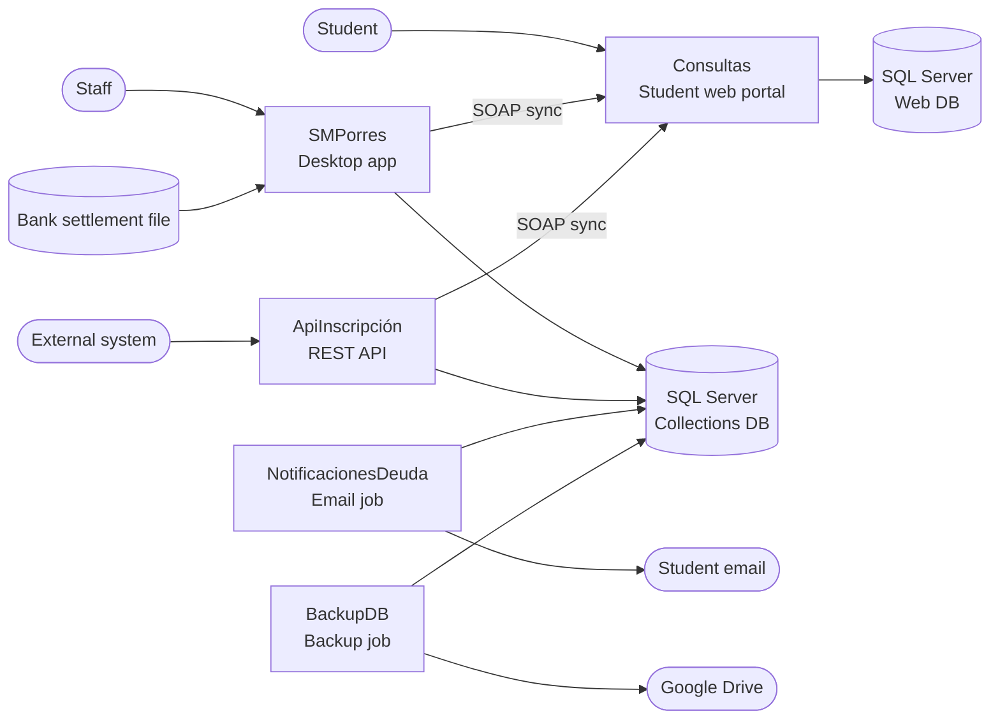
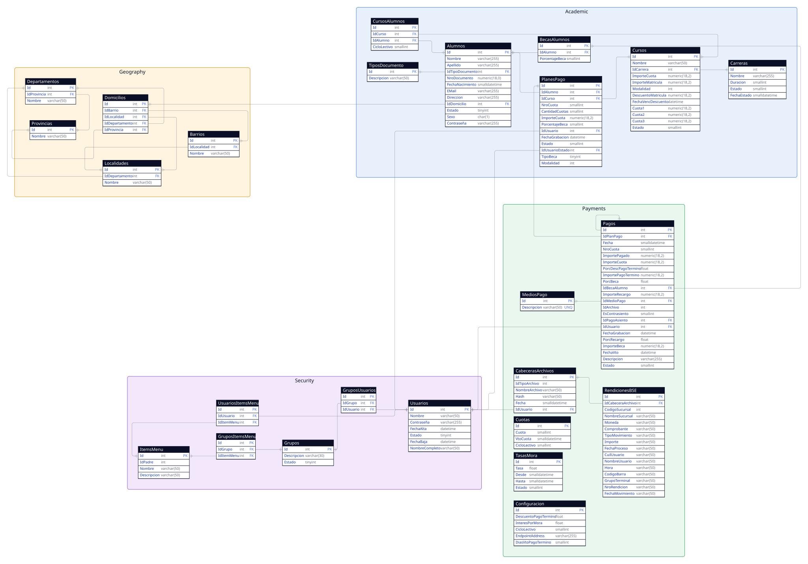

# SMPorres — Tuition Collections System

A tuition and fee collections system built for a technical-career institute in Argentina. It replaces a legacy Access database and a manual reconciliation process with a desktop back-office application, a student web portal, an enrollment REST API and two scheduled utilities, all working over the same business rules. It was designed and built end to end between 2019 and 2020 for a real client.

## The problem it solves

The institute charged an enrollment fee and monthly installments, with scholarships, early-payment discounts and late fees. Payments were made at a bank, and the staff had no reliable way to know who had paid, who owed what, or how much interest a late payer should be charged. Everything was reconciled by hand against a legacy Access database.

This system automates the full cycle: enroll a student, generate a payment plan, issue bank payment slips with a barcode, read the bank's settlement file to register payments, calculate scholarships, discounts and late fees, notify debtors by email, and let students check their own account online.

## What it does

**For administrative staff (desktop application)**
- Manage students, careers, courses, installment calendars, locations (province, department, locality, neighborhood) and users.
- Enroll students in courses and generate a payment plan: an enrollment fee plus monthly installments, depending on the course modality (annual, first semester, second semester, or enrollment fee only).
- Assign scholarships as a percentage per student, with two policies: the scholarship applies only until the installment due date, or it applies always.
- Register a payment manually, or import the bank's settlement file: the system matches each line to an installment, flags lines whose amount does not match, shows the result for review and saves only the valid payments in a single transaction. Loading the same file twice triggers a warning.
- Run reports: students by status, students with overdue installments, total payments by period and payment method, an economic report and a financial report (cash collected between two dates).
- Print bank payment slips and exam enrollment permits.
- Push student, payment and late-fee data to the web portal.
- Control access with users, user groups and per-menu-item permissions, so each role only sees what it needs.

**For students (web portal)**
- Log in and see their courses and account statement: paid, upcoming and overdue installments.
- Choose a payment date and print a payment slip (PDF) with the amount recalculated for that date, including the scholarship, the early-payment discount or the late fee.
- Print an exam permit, available only when the student has no overdue unpaid installments.
- Change their password.

**Automated jobs**
- A debt notification job emails students with overdue installments, with the number of installments owed and the total amount, using an HTML template.
- A backup job takes a database backup, compresses it, uploads it to Google Drive and sends a confirmation email.

**Enrollment API**
- A REST API lets an external system enroll a new student. It validates the data, rejects duplicate documents, creates the student, assigns the initial course of the chosen career, generates the payment plan and publishes the student to the web portal.

## Key business rules

- **Installment amount:** base amount, minus the scholarship, minus the early-payment discount, plus a late fee when applicable. The scholarship and the early-payment discount are mutually exclusive, and the scholarship stops applying after the due date unless the student has the "applies always" policy.
- **Early-payment discount:** a configurable percentage, granted when the installment is paid a configurable number of days before its due date. The enrollment fee has its own discount, valid until a date set per course.
- **Late fee:** calculated per day, using a monthly rate divided by 30. Rates are stored with validity periods, so the fee for a long delay is computed in tranches, each with the rate in force at the time.
- **Bank payment slip:** the barcode is built from a collector code, the payment id, the due date in Julian format (year plus day of year) and the amount, followed by a check digit, according to the specification agreed with the bank.
- **Bank settlement:** the payment id embedded in the barcode lets the system match every line of the bank's file back to the exact installment.

## Architecture

## Data Model

The back-office database runs on SQL Server and the diagram shows its 25 tables and 30 foreign keys, organized in four areas. The diagram source is in `doc/db/er-diagram.d2` (D2), and the SQL that creates and evolves the schema is in the `sql` folder.

- **Academic:** `Carreras` (careers) have many `Cursos` (courses). A student (`Alumnos`) is enrolled in a course for a school year through `CursosAlumnos`, and each enrollment has a payment plan (`PlanesPago`). Scholarships are stored as a percentage per student in `BecasAlumnos`.
- **Payments:** every installment is a row in `Pagos`, linked to its payment plan. The row stores the installment amount together with the scholarship, the early-payment discount and the late fee that were applied, plus the payment date and method (`MediosPago`). `Cuotas` holds the due-date calendar for each school year, `Configuracion` the early-payment discount and its cut-off days, and `TasasMora` the late-fee rates with their validity periods. The bank's settlement files are recorded in `CabecerasArchivos` (name, hash, date and user) and their lines in `RendicionesBSE`.
- **Geography:** `Provincias`, `Departamentos`, `Localidades` and `Barrios` form a hierarchy, and `Domicilios` points to one entry at each level.
- **Security:** `Usuarios` and `Grupos` are linked to the menu entries in `ItemsMenu` through `GruposUsuarios`, `GruposItemsMenu` and `UsuariosItemsMenu`, which is how each role sees only the screens it needs.

The student web portal has its own database, which is not part of this diagram. It holds a copy of what students need to see (their data, courses, installments and late-fee rates), pushed from the back office through the SOAP service.

### Design notes

**Calculated amounts are stored with each payment.** The scholarship, discount and late fee are saved on the `Pagos` row instead of being recalculated, so every installment keeps a record of how its amount was reached.

**Late-fee rates have validity periods.** `TasasMora` stores each rate with a start and end date, which lets the fee for a long delay be computed in tranches, each with the rate that was in force at the time.

**The portal data is denormalized on purpose.** The portal tables store the course and career names and the document type as text, so the public site never needs to reach the internal catalogs.

**Statuses are small numeric codes.** For example, a payment is active, cancelled or paid, and a course is active or inactive. `Cursos.Modalidad` and the scholarship type (applies until the due date, or always) follow the same pattern.

## Key Technical Decisions

**Separate databases for the back office and the public portal.** The student portal has its own database with only the data students need, pushed from the desktop application and the API through a SOAP web service. This keeps the internal collections database off the public-facing site.

**Late fees computed in tranches by rate validity period.** Instead of a single interest rate, the rates live in a table with start and end dates, and the fee for a given payment date is the sum of each tranche's days times the rate in force. The same rules are reused by the desktop app, the web portal and the debt notifications.

**A bank-compatible barcode and automatic reconciliation.** The payment slip barcode encodes enough information (payment id, Julian due date, amount, check digit) for the system to match each line of the bank's settlement file to the exact installment, without manual lookup.

## Repository structure

| Folder | What it contains |
|---|---|
| `src/SMPorres` | Desktop back-office application (Windows Forms): students, courses, plans, payments, bank import, reports, security. |
| `src/Consultas` | Student web portal (ASP.NET MVC) and the SOAP service that receives data from the desktop application. |
| `src/ApiInscripción` | Student enrollment REST API (ASP.NET Web API with JWT authentication). |
| `src/NotificacionesDeuda` | Executable that emails students with overdue installments. |
| `src/BackupDB` | Executable that backs up the database to Google Drive. |
| `src/Utilidades` | Support tool: database connection setup and testers for the web service and the API. |
| `sql` | Database scripts: dated migrations, one-off data scripts, stored procedures for the reports, seed catalogs and test fixtures. |
| `doc` | Project documentation, in Spanish: requirements, payment rules, bank homologation material and the delivered-work summary. |
| `install` | Inno Setup scripts that build the installers. |
| `lib` | In-house and third-party libraries referenced by the projects. |
| `other` | Auto-update launcher for the desktop application and a small email/template test project. |
| `img` | Logos and icons. |

The solution file is `src/SMPorres.sln`.

## Technology

- **Language and platform:** C#, .NET Framework 4.6.1
- **Desktop:** Windows Forms, Crystal Reports
- **Web:** ASP.NET MVC 5, Bootstrap, ASP.NET Web API 2 with JWT, SOAP web service (ASMX)
- **Data:** SQL Server, Entity Framework 6 (database-first), stored procedures, dated SQL migrations
- **Other:** log4net, RazorEngine for email templates, Google Drive API, Inno Setup installers

## Running it locally

1. Open `src/SMPorres.sln` in Visual Studio 2015 or later, with the .NET Framework 4.6.1 targeting pack, and restore the NuGet packages.
2. Create a SQL Server database and run `sql/Migraciones/Deployed/Base de datos completa.sql`, then the pending scripts in `sql/Migraciones`, then the catalogs in `sql/Seeds` and the stored procedures in `sql/Stored Procs`.
3. Set your own connection string in each project's configuration file, or store an encrypted one in the Windows registry with the `Utilidades` tool.
4. Run `SMPorres` for the desktop application, or `Consultas` and `ApiInscripción` for the web projects. The Crystal Reports runtime is required to preview reports.

## Status

Built and delivered to the client during 2019 and 2020. Some modules, such as the debt notifications and the exam permit, were still pending installation when that summary was written. This repository is kept as a portfolio sample and is not under active development.

## License

This project is publicly available for viewing and educational purposes only.
No permission is granted to use, modify, or distribute this code without explicit authorization.
